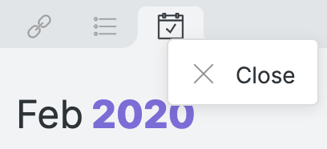
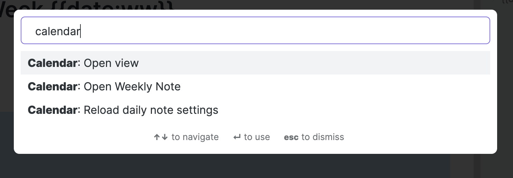
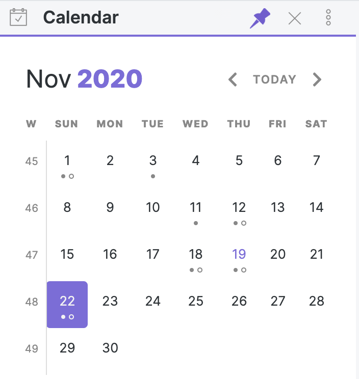
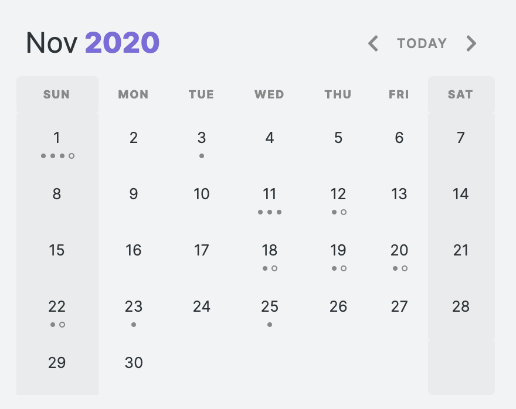

# Calendar+ (obsidian-calendar-plugin fork)

This plugin for [Obsidian](https://obsidian.md/) creates a simple Calendar view for visualizing and navigating between your daily notes.


## Usage

After enabling the plugin in the settings menu, you should see the calendar view appear in the right sidebar.

The plugin reads your Daily Note settings to know your date format, your daily note template location, and the location for new daily notes it creates.

## Features

- Go to any **daily note**.
- Create new daily notes for days that don't have one. (This is helpful for when you need to backfill old notes or if you're planning ahead for future notes! This will use your current **daily note** template!)
- Visualize your writing. Each day includes a meter to approximate how much you've written that day.
- Use **Weekly notes** for an added organization layer! They work just like daily notes, but have their own customization options.

## Features (Calendar+ Fork)

### Core Features (from upstream)
- Go to any **daily note**.
- Create new daily notes for days that don't have one.
- Visualize your writing. Each day includes a meter to approximate how much you've written that day.
- Use **Weekly notes** for an added organization layer.

### Day Markers (v1.1+)
- **Holidays**: Automatically fetched from [timor.tech](https://timor.tech/) API, cached locally for 7 days. Highlighted in red on the calendar.
- **Leave Days**: Detected from daily note frontmatter `tags` (configurable tag name, default: `请假`). Highlighted in blue.
- **Makeup Workdays**: Fetched from the same API, highlighted in orange.
- Toggle on/off from Settings > Day Markers > Show day markers.

### Status Tags (v2.0+)
- Parse `status` field and `tags` array in daily note frontmatter to display status emojis and colors.
- 13 built-in status presets: leave, outing, class, slack, sick, travel, remote, holiday, overtime, meeting, study, rest, exercise.
- Supports Chinese, English, and emoji aliases (e.g. `请假`/`leave`/`🏖️` all resolve to the same status).
- Fuzzy matching for typos (edit distance ≤ 2).
- Custom status tags with user-defined aliases, colors, and emojis.
- Backward compatible with the `leaveDayTag` setting.

**Example frontmatter:**
```yaml
---
date: 2026-07-24
tags:
  - 日报
  - 请假
status: leave       # explicit status (highest priority)
mood: great         # mood tracking
weather: sunny      # auto-written by Weather module
temperature: 32
---
```

### Mood Tracking (v2.0+)
- Read `mood` field from daily note frontmatter and display mood emoji on the calendar.
- 5 built-in mood presets: great (😄), good (🙂), okay (😐), bad (😕), awful (😢).
- Supports multiple moods per day (array in frontmatter).
- Mood emoji appears in the bottom-right corner of each day cell.

### Weather Auto-Fetch (v2.0+)
- Automatically fetch weather data from [Open-Meteo](https://open-meteo.com/) (free, no API key required).
- **City detection**: IP-based geolocation (automatic) or manual city name input. User input takes priority.
- **Auto-write**: When enabled, weather data is automatically written to daily note frontmatter (`weather`, `weather_name`, `temperature`, `weather_wmo`).
- Existing weather data in frontmatter is never overwritten.
- 14 WMO weather code mappings with emoji and Chinese/English labels.
- Historical weather data available via Open-Meteo Archive API (for past dates).
- Caching: Current day weather cached for 2 hours, historical weather cached permanently.

**Settings:**
- `Enable weather auto-fetch` (toggle, default: off)
- `City` (text, empty = IP auto-detect)
- `Auto-write to daily note` (toggle, default: on)

**Frontmatter fields written:**
```yaml
weather: sunny        # canonical weather ID
weather_name: 晴      # Chinese label
temperature: 32       # temperature in °C
weather_wmo: 0        # WMO weather code
```

## Settings

### General Settings

- **Start week on [default: locale]**: Configure the Calendar view to show Sunday or Monday as the first day of the week. Choosing 'locale' will set the start day to be whatever is the default for your chosen locale (`Settings > About > Language`)
- **Words per Dot [default: 250]**: Starting in version 1.3, dots reflect the word count of your files. By default, each dot represents 250 words, you can change that value to whatever you want. Set this to `0` to disable the word count entirely. **Note:** There is a max of 5 dots so that the view doesn't get too big!
- **Confirm before creating new note [default: on]**: If you don't like that a modal prompts you before creating a new daily note, you can turn it off.
- **Show Week Number [default: off]**: Enable this to add a new column to the calendar view showing the [Week Number](https://en.wikipedia.org/wiki/Week#Week_numbering). Clicking on these cells will open your **weekly note**.

### Day Markers

- **Show day markers [default: on]**: Highlight holidays, leave days, and makeup workdays on the calendar.
- **Holiday API URL [default: https://timor.tech/api/holiday/year/]**: API endpoint for fetching public holidays. Year is appended automatically.
- **Leave day tag [default: 请假]**: Tag in daily note frontmatter that marks a leave day.

### Status Tags

- **Enable status tags [default: on]**: Parse frontmatter status/tags to display status emojis and colors on the calendar. Supports 13 built-in presets + custom statuses with alias resolution.

### Mood Tracking

- **Enable mood tracking [default: off]**: Read mood from daily note frontmatter and display mood emoji on the calendar.
- **Mood field name [default: mood]**: Frontmatter field name for mood data.

### Weather (Auto-Fetch)

- **Enable weather auto-fetch [default: off]**: Automatically fetch weather data from Open-Meteo and display on the calendar. City is auto-detected via IP, or you can specify manually.
- **City [default: empty]**: Enter your city name for weather lookups. Leave empty to use IP-based auto-detection.
- **Auto-write to daily note [default: on]**: Automatically write weather data to daily note frontmatter when creating or opening a note.

## Customization

The following CSS Variables can be overridden in your `obsidian.css` file.

```css
/* obsidian-calendar-plugin */
/* https://github.com/liamcain/obsidian-calendar-plugin */

#calendar-container {
  --color-background-heading: transparent;
  --color-background-day: transparent;
  --color-background-weeknum: transparent;
  --color-background-weekend: transparent;

  --color-dot: var(--text-muted);
  --color-arrow: var(--text-muted);
  --color-button: var(--text-muted);

  --color-text-title: var(--text-normal);
  --color-text-heading: var(--text-muted);
  --color-text-day: var(--text-normal);
  --color-text-today: var(--interactive-accent);
  --color-text-weeknum: var(--text-muted);

  /* Calendar+ Day Markers */
  --status-emoji-size: 10px;
  --mood-emoji-size: 10px;
  --weather-emoji-size: 9px;
  --status-label-font-size: 8px;
}
```

In addition to the CSS Variables, there are some classes you can override for further customization. For example, if you don't like how bright the title is, you can override it with:

```css
#calendar-container .year {
  color: var(--text-normal);
}
```

> **Note:** It's especially important when overriding the classes to prefix them with `#calendar-container` to avoid any unexpected changes within Obsidian!

### Caution to Theme Creators

If you use "Inspect Element" on the calendar, you will notice that the CSS classes are quite illegible. For example: `.task.svelte-1lgyrog.svelte-1lgyrog`. What's going on here? The classes that begin with `svelte-` are autogenerated and are used to avoid the calendar styles affecting any other elements in the app. That being said: **ignore them!** Those CSS classes are likely to change from release to release, and your overrides _will_ break. Just target the human-readable part of the class names. So to override `task.svelte-1lgyrog.svelte-1lgyrog`, you should use `#calendar-container .task { ... }`

## Compatibility

`obsidian-calendar-plugin` currently requires Obsidian v0.9.11 or above to work properly.

## Installation

You can install the plugin via the Community Plugins tab within Obsidian. Just search for "Calendar."

## FAQ

### What do the dots mean?

Each solid dot represents 250 words in your daily note. So 4 dots means you've written a thousands words for that day! If you want to change that threshold, you can set a different value for "Words Per Dot" in the Calendar settings.

The hollow dots, on the other hand, mean that the day has incomplete tasks in it. (**Note:** There will only ever be 1 hollow dot on a particular day, regardless of the number of remaining tasks)

### How do I change the styling of the Calendar?

By default, the calendar should seamlessly match your theme, but if you'd like to further customize it, you can! In your `obsidian.css` file (inside your vault) you can configure the styling to your heart's content.

### Can I add week numbers to the calendar?

In the settings, you can enable "Show Week Numbers" to add a "week number" column to the calendar. Click on the week number to open a "weekly note".

### How do I hide the calendar plugin without disabling the plugin?

Just like other sidebar views (e.g. Backlinks, Outline), the calendar view can be closed by right-clicking on the view icon.



### I accidentally closed the calendar. How do I reopen it?

If you close the calendar widget (right-clicking on the panel nav and clicking close), you can always reopen the view from the Command Palette. Just search for `Calendar: Open view`.



### How do I have the calendar start on Monday?

From the Settings menu, you can toggle "Start week on Monday".

### How do I include "unformatted" words in my weekly note filenames?

If you want the weekly note format to include a word (e.g. "Week 21 of Year 2020") you can do so by surrounding the words with `[]` brackets. This tells [moment](https://momentjs.com/docs/#/displaying/format/) to ignore the words. So for the example above, you would set your format to `[Week] ww [of Year] gggg`.

### What do the colored backgrounds mean?

- **Red background**: Public holiday (fetched from timor.tech API)
- **Blue background**: Leave day (detected from frontmatter tag, e.g. `请假`)
- **Orange background**: Makeup workday (weekend that is a working day, from API)

You can toggle these markers in Settings > Day Markers > Show day markers.

### How do status tags work?

Write a `status` field or add a status tag to your daily note frontmatter:

```yaml
---
status: travel
tags:
  - 日报
  - 出差
---
```

The calendar will display the corresponding emoji (✈️ for travel) and color on that day. The plugin recognizes 13 preset statuses in Chinese, English, and emoji. You can also add custom statuses via the StatusConfigStore.

### How does the weather auto-fetch work?

Enable it in Settings > Weather (Auto-Fetch). The plugin will:
1. Detect your location via IP geolocation (or use a city you specify)
2. Fetch weather from Open-Meteo (free, no API key)
3. Auto-write weather data to your daily note frontmatter
4. Display a weather emoji in the top-left corner of each day cell

Weather data is cached to minimize API calls. The plugin never overwrites weather data you've manually edited.

### Can I use custom status tags?

Yes. The `StatusConfigStore` supports custom statuses with user-defined aliases, colors, and emojis. Custom aliases override preset aliases. You can also disable built-in presets you don't need.

### I don't like showing the week numbers but I still want to use weekly notes. Can I still use them?

You can open the current weekly note from the command palette by searching `Calendar: Open weekly Note`. This will open the weekly note for the current week.

To configure the `format`, `folder`, and `template`, you will temporarily need to toggle on "Show weekly numbers" in the settings, but if you toggle it back off, your settings will persist.

## Protips

### Embed your entire week in a weekly note

If you add the following snippet to your weekly note template, you can a seamless view of your week in a single click.

```md
## Week at a Glance

![[{{sunday:gggg-MM-DD}}]]
![[{{monday:gggg-MM-DD}}]]
![[{{tuesday:gggg-MM-DD}}]]
![[{{wednesday:gggg-MM-DD}}]]
![[{{thursday:gggg-MM-DD}}]]
![[{{friday:gggg-MM-DD}}]]
![[{{saturday:gggg-MM-DD}}]]
```

### Hover Preview

Just like the Obsidian's graph and internal links, the calendar supports page previews for your daily notes. Just hover over a cell while holding down `Ctrl/Cmd` on your keyboard!

### The calendar can be moved (and pinned!) anywhere

Just because the calendar appears in the right sidebar doesn't mean it has to stay there. Feel free to drag it to the left sidebar, or (if you have the screen real estate for it) into the main content area. If you move it out of the sidebar, the view can even be pinned; great for more advanced tile layouts!



### Open daily notes in a new split

If you `Ctrl/Command`-Click on a note in your calendar, it will open daily note in a new split. Useful if you want to open a bunch of daily notes in a row (especially if you have the **Sliding Panes** plugin enabled!)

### Reveal open note on calendar

If you open a note from a different month, you might want to see it on the calendar view. To do so, you can run the command `Calendar: Reveal open note` from the command palette.

### Add custom styling for weekends

If you want to style weekends to be distinguishable from weekdays, you can set the `var(--color-background-weekend)` to be any color you want.



### Weekly Notes (deprecated)

#### Weekly notes have a new home

The weekly note functionality has been split out into its [very own plugin](https://github.com/liamcain/obsidian-periodic-notes/). In the future, the functionality will be removed from the Calendar plugin; so if you're currently using weekly notes, I encourage you to make the switch. Don't worry, the behavior is functionally identical and will still integrate with the calendar view!

This split was inspired by the [One Thing Well](https://en.wikipedia.org/wiki/Unix_philosophy) philosophy. Plugins should be as modular. Some users might want weekly notes and have no use for a calendar view. And vice versa.

If you are currently using weekly notes within the Calendar plugin, the new Periodic Notes plugin will migrate your settings for you automatically.

### Usage

You can open **weekly notes** in 2 ways: searching `Calendar: open weekly note` in the command palette or by clicking on the week number. Weekly notes can be configured from the Calendar settings. There are 3 settings:

- **Folder:** The folder that your weekly notes go into. It can be the same or different from your daily notes. By default they are placed in your vault root.
- **Template:** Configure a template for weekly notes. Weekly notes have slightly different template tags than daily notes. See here for the list of supported [weekly note template tags](#template-tags).

> Note: The path here won't autocomplete for you, you'll need to enter the full path.

- **Format:** The date format for the weekly note filename. Defaults to `"gggg-[W]ww`. If you use `DD` in the week format, this will refer to first day of the week (Sunday or Monday, depending on your settings).

#### Template Tags

| Tag                                                                                    | Description                                                                                                                                                                                                  |
| -------------------------------------------------------------------------------------- | ------------------------------------------------------------------------------------------------------------------------------------------------------------------------------------------------------------ |
| `sunday`, `monday`, `tuesday`, `wednesday`, `thursday`, `friday`, `saturday`, `sunday` | Because weekly tags refer to main days, you can refer to individual days like this `{{sunday:gggg-MM-DD}}` to automatically insert the date for that particular day. Note, you must specify the date format! |
| `title`                                                                                | Works the same as the daily note `{{title}}`. It will insert the title of the note                                                                                                                           |
| `date`, `time`                                                                         | Works the same as the daily note `{{date}}` and `{{time}}`. It will insert the date and time of the first day of the week. Useful for creating a heading (e.g. `# # {{date:gggg [Week] ww}}`).               |

## See it in action

- [Nick Milo provides a nice plugin walkthrough](https://www.youtube.com/watch?v=X61wRmfZU8Y&t=1099s)
- [Santi Younger demos how Calendar + Periodic Notes can be used for weekly review](https://www.youtube.com/watch?v=T9y8JABS9_Q)
- [Filipe Donadio uses the calendar to plan his day](https://www.youtube.com/watch?v=hxf3_dXIcqc)

## Say Thanks 🙏

If you like this plugin and would like to buy me a coffee, you can!

[](https://www.buymeacoffee.com/liamcain)

Like my work and want to see more like it? You can sponsor me.

[](https://github.com/sponsors/liamcain)
